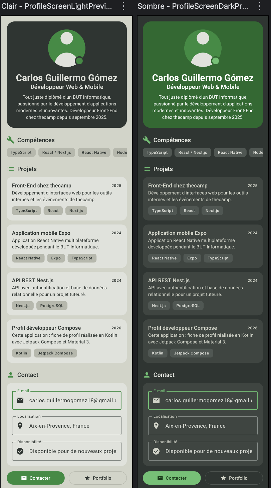
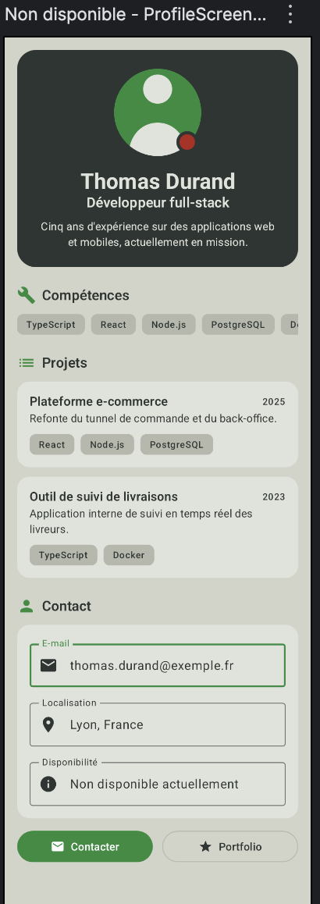

# Profil développeur Compose 2

Dépôt : https://github.com/CJG2/profil-developper-carlos-guillermogomez-2

Nouvelle version de l'application « Profil développeur », réalisée pour le devoir *Amélioration UI*.
La première version reste disponible dans son propre dépôt : https://github.com/CJG2/profil-developper-carlos-guillermogomez

Carlos Guillermo Gomez - ESGI 4 IW - Aix en provence

## Description

L'application affiche la fiche d'un développeur sur un seul écran qui défile :

- un **en-tête** avec un avatar, le nom, le rôle et une courte description ;
- les **compétences**, sous forme de pastilles qui défilent horizontalement ;
- les **projets**, chacun dans une carte avec son année et ses technologies ;
- une zone de **contact** (e-mail, localisation, disponibilité) ;
- deux **actions** : « Contacter » et « Portfolio ».

Toutes les données sont locales, écrites directement en Kotlin dans `data/ProfileData.kt`.
Les clics sur les boutons sont remontés au parent par des callbacks, qui ne font rien pour l'instant.

## Organisation du code

```
com.example.profildeveloppeurcarlos/
├── MainActivity.kt          thème + Scaffold + ProfileScreen
├── model/                   Profile, Project (data class)
├── data/ProfileData.kt      données locales (carlosProfile, thomasProfile)
├── ui/screens/              ProfileScreen (LazyColumn) + previews de l'écran
├── ui/components/           composants réutilisables + leurs previews
└── ui/theme/                Color, Theme, Type, Shapes
```

| Composant | Rôle |
|---|---|
| `ProfileAvatar` | Avatar rond avec une pastille de disponibilité superposée |
| `ProfileHeader` | En-tête : avatar, nom, rôle, description |
| `SectionTitle` | Icône + titre de section |
| `TechnologyChip` | Pastille utilisée pour les compétences et les technologies des projets |
| `ProjectCard` | Carte d'un projet |
| `ContactSection` / `ContactField` | Carte de contact avec des champs en lecture seule |
| `ProfileActions` | Boutons « Contacter » et « Portfolio » |

## Composants Compose utilisés

- `Text` : nom, rôle, descriptions, titres, années.
- `Button` : action principale « Contacter ».
- `OutlinedButton` : action secondaire « Portfolio ».
- `Icon` : titres de section, champs de contact et boutons (icônes Material).
- `Image` : avatar, chargé depuis un vector drawable avec `painterResource`.
- `Card` : cartes des projets et carte de contact.
- `OutlinedTextField` en **lecture seule** (`readOnly = true`) et sur **une seule ligne** (`singleLine = true`) : e-mail, localisation et disponibilité. Tous les champs gardent ainsi la même hauteur ; une valeur trop longue est coupée à l'affichage.
- `Surface` : en-tête du profil et pastilles `TechnologyChip`.
- `Scaffold` : structure de l'écran dans `MainActivity`.

## Layouts utilisés

- `Column` : contenu de l'en-tête, des cartes de projet et de la carte de contact.
- `Row` : icône + titre de section, titre + année d'un projet, technologies d'un projet, ligne des deux boutons.
- `Box` : avatar, avec la pastille de disponibilité superposée en bas à droite (`Alignment.BottomEnd`).
- `Spacer` : espaces dans l'en-tête, les cartes et les boutons.
- `LazyColumn` : l'écran entier.
- `LazyRow` : la liste des compétences.

## Listes avec LazyColumn et LazyRow

L'écran `ProfileScreen` est une **`LazyColumn`** : elle empile les sections et fait défiler la page.

- Les sections uniques (en-tête, titres, contact, boutons) sont ajoutées avec `item { }`.
- Les projets sont ajoutés avec `items(profile.projects, key = { it.title }) { project -> ProjectCard(project) }` : un `ProjectCard` est créé pour chaque projet de la liste. La `key` permet à Compose d'identifier chaque projet.
- Les marges et les espacements sont gérés par la liste elle-même (`contentPadding` et `verticalArrangement = Arrangement.spacedBy(12.dp)`).

Les compétences sont affichées dans une **`LazyRow`**, à l'intérieur de la `LazyColumn` : `items(profile.skills) { skill -> TechnologyChip(skill) }`. Elles défilent horizontalement, ce qui évite d'avoir une longue liste verticale de compétences.

Le même composant `TechnologyChip` sert aussi aux technologies de chaque `ProjectCard`.

## Choix du thème

Le thème est dans `ui/theme/` et s'appuie sur Material Design 3.

- **Couleurs (`MaterialTheme.colorScheme`)** : une palette sobre gris-vert (Gunmetal, Dust Grey, Soft Linen) avec un vert (`ForestGreen`) comme couleur principale. Les couleurs dynamiques d'Android 12+ sont désactivées (`dynamicColor = false`), pour que l'app garde la même identité sur tous les téléphones.
- **Clair / sombre** : deux `ColorScheme` (`LightColorScheme`, `DarkColorScheme`). Le thème choisit automatiquement avec `isSystemInDarkTheme()`.
  - En clair : fond gris, cartes plus claires, en-tête foncé pour le mettre en avant.
  - En sombre : fond Gunmetal, cartes un peu plus claires que le fond, et un vert plus lumineux (`ForestGreenLight`) pour garder un bon contraste.
  - Les rôles `surfaceContainer*` sont définis pour que les `Card` utilisent la palette et non la teinte violette par défaut de Material. Les pastilles (`secondaryContainer`) ont une couleur différente du fond et des cartes pour rester visibles dans les deux modes.
- **Typographie (`MaterialTheme.typography`)** : `headlineMedium` pour le nom, `titleMedium` pour le rôle et les titres de section, `titleSmall` pour les titres de projet, `bodyMedium` pour les descriptions, `labelMedium` pour les pastilles.
- **Formes (`MaterialTheme.shapes`)** : `small` (8dp) pour les pastilles, `medium` (16dp) pour les cartes, `large` (24dp) pour l'en-tête.

## Captures d'écran

Les captures sont prises depuis les **previews d'Android Studio**, et non depuis un émulateur.
Les previews utilisent exactement le même code et le même thème que l'application ; le mode sombre est obtenu avec `uiMode = Configuration.UI_MODE_NIGHT_YES`, comme le réglage système d'un téléphone.
Les previews d'écran font 1600dp de haut : chaque capture montre la page entière, sans avoir à faire défiler.
Le défilement de la page, le défilement horizontal des compétences et les clics sur les boutons ont été testés avec le **mode interactif** des previews.
La bordure verte du champ « E-mail » vient d'un clic dans ce mode : un champ en lecture seule peut toujours recevoir le focus, mais son texte ne peut pas être modifié.

### Profil disponible, thème clair et sombre



À gauche le thème clair, à droite le thème sombre, avec le même code.
L'en-tête passe de Gunmetal à vert foncé, les cartes restent plus claires que le fond et les pastilles se détachent des cartes dans les deux modes.
La pastille verte sur l'avatar indique que le profil est disponible.
L'e-mail et la disponibilité sont coupés en fin de ligne à cause de `singleLine = true`.

### Profil non disponible (réutilisation des composants avec d'autres données)



Le même `ProfileScreen` affiche un autre profil (`thomasProfile`) : la pastille de l'avatar devient rouge et le champ « Disponibilité » affiche « Non disponible actuellement » avec une autre icône.
La liste des projets ne contient que deux `ProjectCard`, car `items()` s'adapte au nombre d'éléments.

## Previews

- `ProfileScreenLightPreview`, `ProfileScreenDarkPreview`, `ProfileScreenUnavailablePreview` : l'écran complet en clair, en sombre et avec un profil non disponible.
- `ProfileAvatarPreview`, `ProfileHeaderPreview`, `SectionTitlePreview`, `TechnologyChipPreview`, `ProjectCardPreview`, `ContactSectionPreview`, `ProfileActionsPreview` : chaque composant seul.

## Quelles notions du chapitre Compose UI avez-vous réutilisées dans cette application ?

J'ai réutilisé les **composants fondamentaux** (`Text`, `Button`, `Icon`, `Image`, `Card`, `OutlinedTextField` en lecture seule) et les **layouts** (`Column`, `Row`, `Box`, `Spacer`, `Surface`) pour construire chaque partie de l'écran.
J'ai remplacé la simple boucle de la première version par des **listes modernes** : une `LazyColumn` pour l'écran et les projets, et une `LazyRow` pour les compétences.
Chaque élément de liste est un **composable réutilisable** (`ProjectCard`, `TechnologyChip`) qui reçoit ses données en paramètres ; la preview « Non disponible » le montre en affichant un autre profil avec les mêmes composants.
Enfin, j'ai personnalisé **Material Design 3** (`colorScheme`, `typography`, `shapes`) avec un **thème clair et un thème sombre**, en vérifiant que les pastilles, les cartes et les bordures restent lisibles dans les deux modes.
